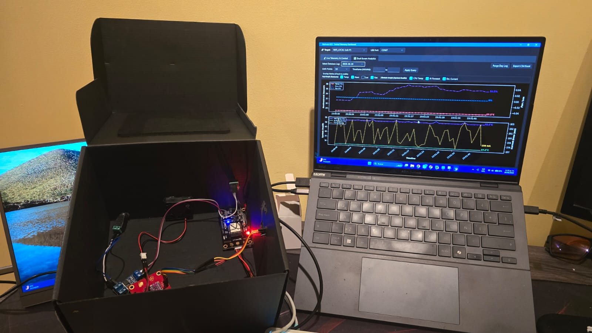
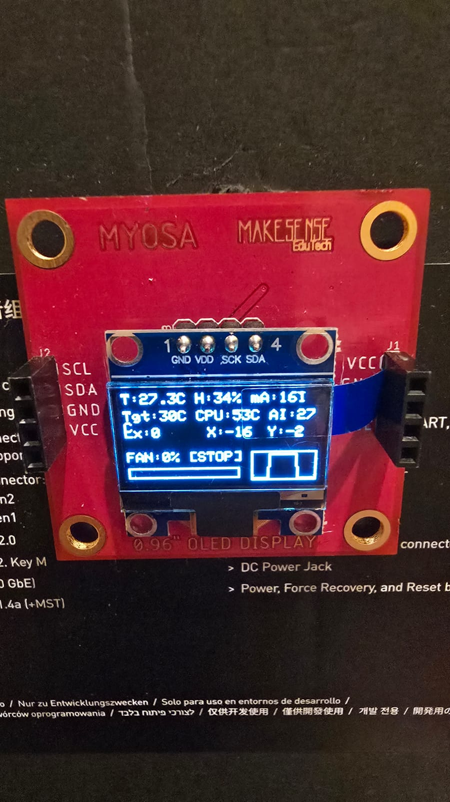
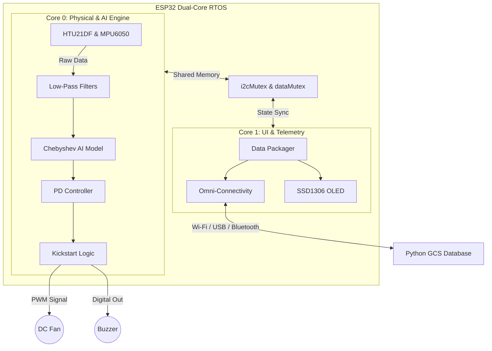
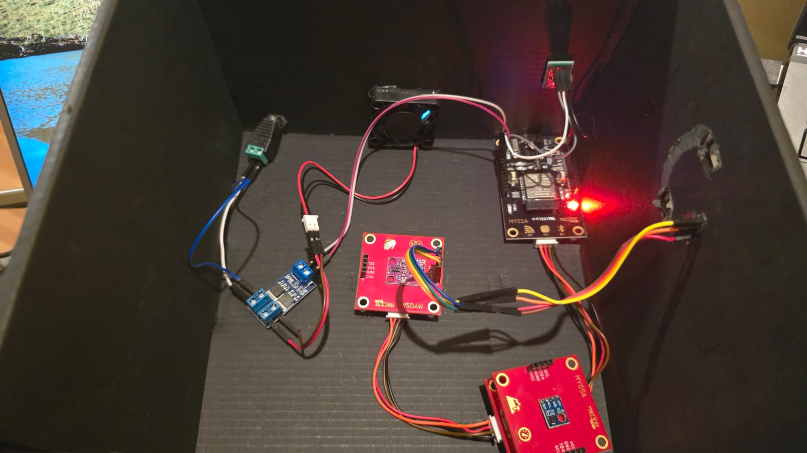
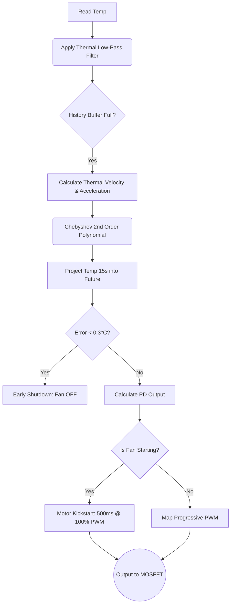
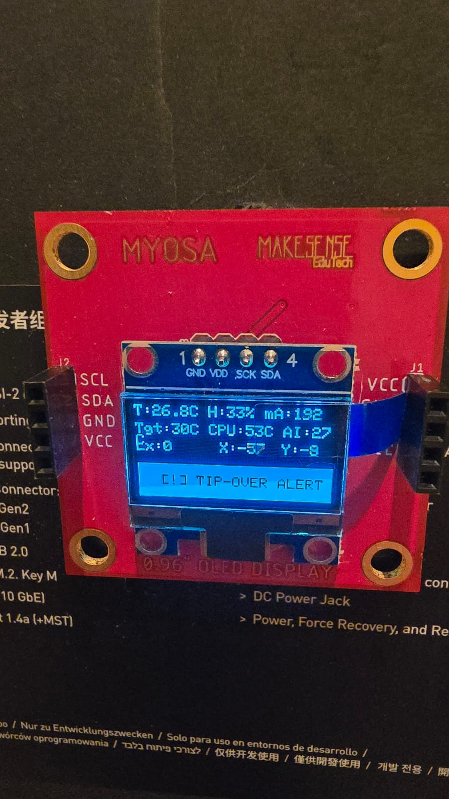
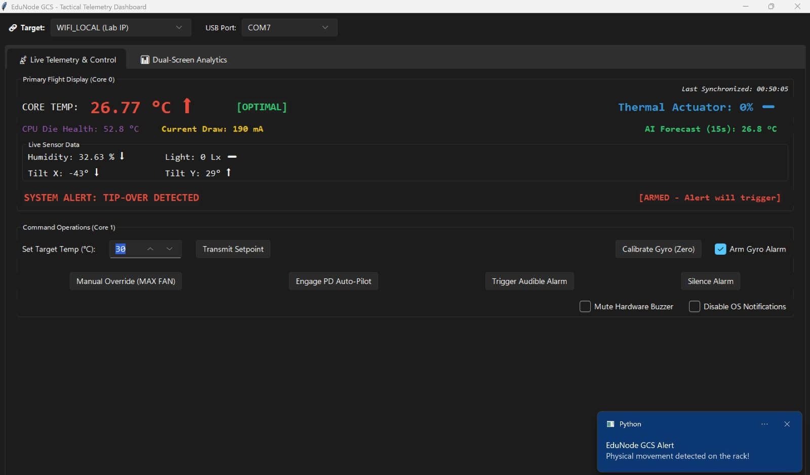
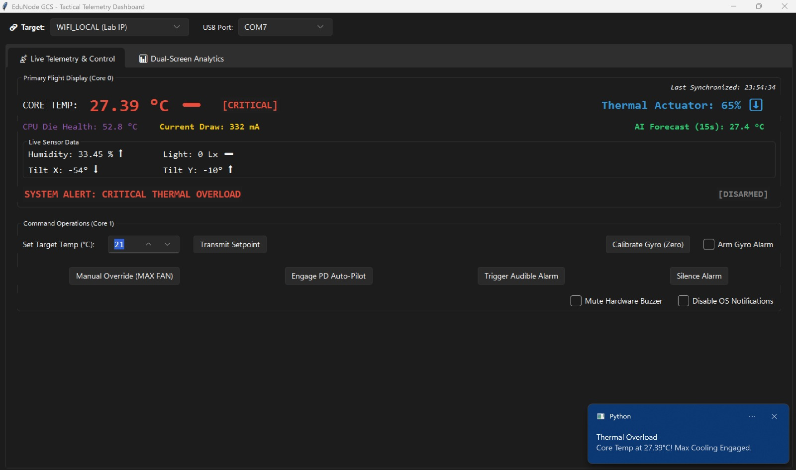
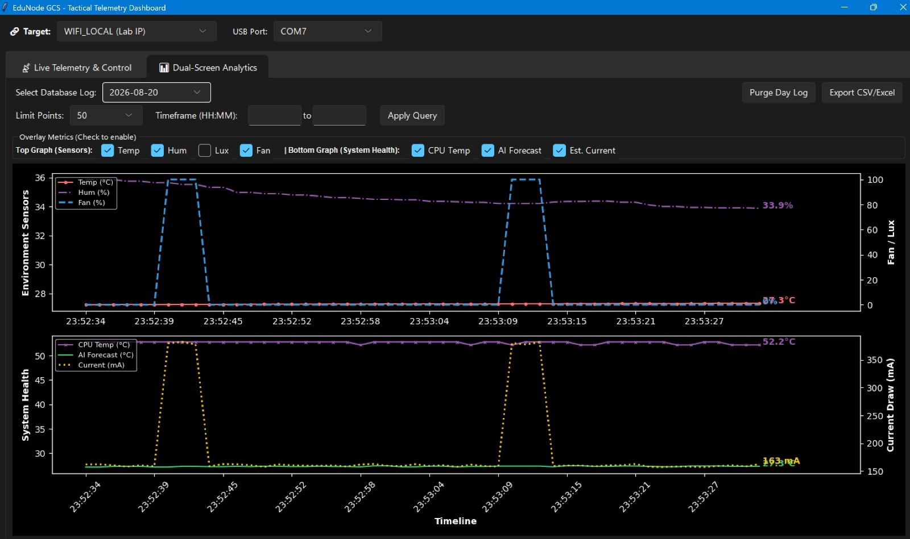
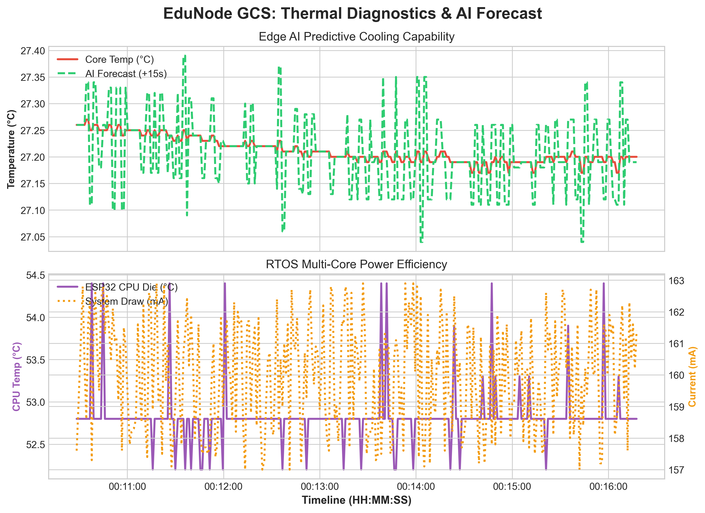

# EduNode GCS: Autonomous Edge AI Telemetry Station 🚀
**A MYOSA 6.0 Project Submission**

**Authors:** Luis Eduardo Arenas Deseano & Lixin Tu
**Tech Stack:** C++ (FreeRTOS) | Python | PostgreSQL | Edge AI

## 📌 1. Project Abstract
The EduNode Ground Control Station (GCS) is a low-cost, scaled prototype designed to monitor and protect critical UAV flight hardware in changing environments. By utilizing a dual-core RTOS architecture on an ESP32, the system processes environmental telemetry, physical security (intrusion/tip-over), and thermal control simultaneously without CPU throttling.

It features **Omni-Connectivity**, transmitting live data to a Python-based graphical dashboard seamlessly via Wi-Fi, USB Serial cable, or Bluetooth, ensuring operation with or without an active internet connection.

## 🧠 2. Edge AI & Thermal Forecasting
Instead of reacting to heat after it accumulates, EduNode predicts it. We implemented a 2nd-Order Chebyshev Polynomial model running natively on the ESP32. The AI calculates thermal velocity and acceleration, predicting the core temperature 15 seconds into the future. 

This enables the cooling actuator to engage preemptively, preventing thermal spikes before they damage the hardware.

*Fig 1. Real-time OLED display showing AI forecasting, internal CPU Die health, and live current estimation.*

## ⚙️ 3. Hardware Architecture & RTOS
The system operates on FreeRTOS, dividing tasks across the ESP32's dual cores to maximize efficiency. 
*   **Core 0:** Dedicated to high-speed sensor polling, AI mathematical forecasting, and hardware actuation.
*   **Core 1:** Handles Omni-Connectivity transmission and OLED rendering.

To prevent I2C bus collisions between cores, a strict `i2cMutex` semaphore was implemented, ensuring flawless data flow.

*Fig 2. Hardware topology displaying the master microcontroller and sensor arrays prepared for multiprocessing.*

## 🌬️ 4. Overcoming Physics: The Fan Kickstart
DC fan motors suffer from "Stall Voltage" (static friction) at low speeds. EduNode solves this using an algorithmic Kickstart. When the AI demands cooling, the system injects a 500ms 100% PWM burst to break the friction, then maps into a progressive lower-power curve (45% - 100%), ensuring physical airflow while saving battery.

## 🛡️ 5. Physical Security & Real-Time Tamper Alerts
The mini-rack enclosure is strictly monitored for unauthorized physical access. Utilizing an APDS9960 (Optical Intrusion) and an MPU6050 (Tip-Over Alarm), the system generates instant, real-time alerts if the ground station falls, is moved, or if someone attempts to open the enclosure without authorization.

*Fig 3. Hardware OLED immediately displaying an unauthorized box intrusion alert.*

*Fig 4. Python GCS reflecting the real-time physical tamper alert from the gyroscope.*

Furthermore, the system guarantees maximum protection against extreme environmental factors. If the internal temperature surpasses the configured critical risk threshold, a thermal overload protocol is engaged.

*Fig 5. Python Dashboard catching a Critical Thermal Overload, triggering a native Windows OS notification.*

## 📊 6. Performance Results & CPU Health
Our analytics dashboard logs data locally to a PostgreSQL database. The bottom graph tracks system health. Notice the flat, stable purple line: the internal ESP32 CPU Die temperature remains absolutely stable, proving the FreeRTOS multiprocessing handles the AI workload without any thermal throttling.

*Fig 6. Dual-Screen Analytics displaying the calculated Current Draw (mA) and the predictive AI cooling spikes.*

*Fig 7. Standalone Matplotlib High-Resolution Export displaying timeline metrics.*

## 🏁 7. Conclusion
This project demonstrates the critical importance of multi-core programming in Edge Computing. By efficiently distributing the workload across the ESP32 processors, we ensure battery savings and guarantee that the system can operate 24/7 without thermal throttling. The EduNode GCS successfully proves that the MYOSA development board is fully equipped and ready to handle professional, industrial-grade environments for continuous mini-rack protection and monitoring.

## 🎥 8. Video Demonstration
[Watch the System in Action on YouTube](#) *(Replace this text with your YouTube/Drive Link)*

## 🛠️ 9. How to Run This Project
1. Open the `Firmware/EduNode_RTOS.ino` in Arduino IDE and flash it to the ESP32.
2. In your terminal, navigate to the `Ground_Control_Station/` folder.
3. Install dependencies: `pip install -r requirements.txt`
4. Run the station: `python EduNode_GCS.py`
5. *(Optional)* To generate standalone HD graphs, run: `python generate_graphs.py`
